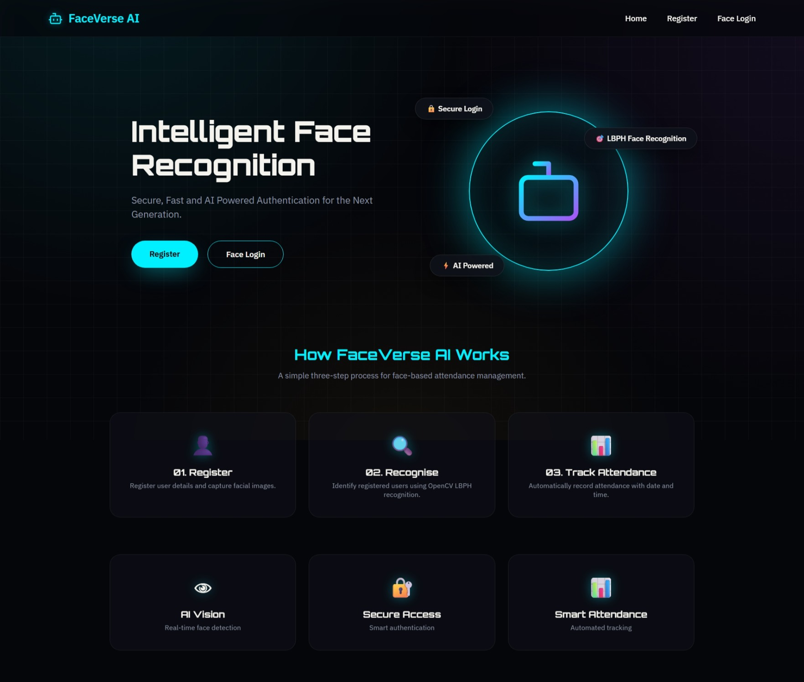
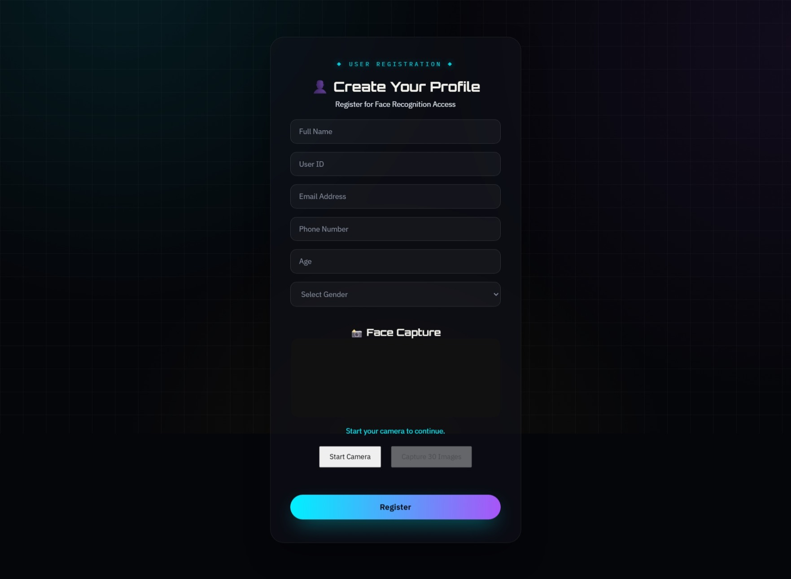
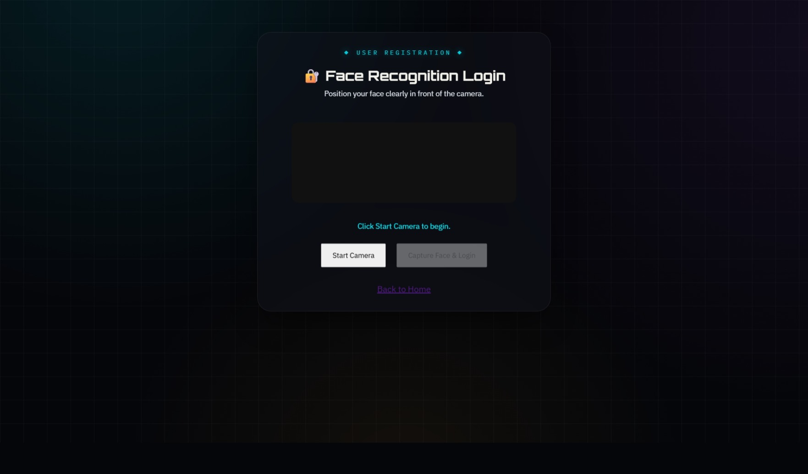
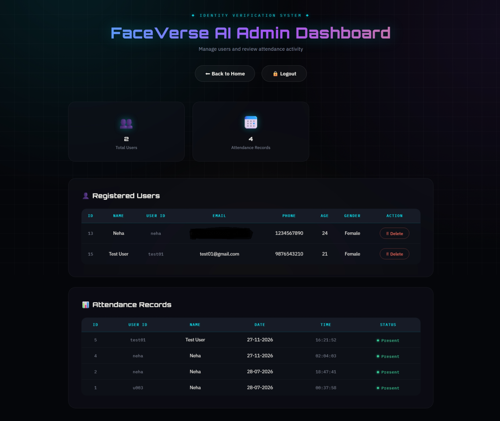

# FaceVerse AI – Face Recognition Attendance System

FaceVerse AI is a web-based face recognition attendance management system developed using Python, Flask, OpenCV and SQLite. It enables users to register through facial images, log in using face recognition, and record attendance automatically.

## Features

- User registration using a webcam
- Face recognition-based login
- Automated attendance recording
- Daily attendance tracking
- Admin login and dashboard
- User management and attendance monitoring
- Search and filter attendance records

## Technologies Used

- **Programming Language:** Python
- **Backend:** Flask
- **Frontend:** HTML, CSS, JavaScript
- **Face Recognition:** OpenCV (LBPH)
- **Database:** SQLite
- **Libraries:** NumPy

## Project Structure

```text
FaceVerse-AI/
├── app.py
├── camera.py
├── database.py
├── recognizer.py
├── train_model.py
├── requirements.txt
├── .gitignore
├── static/
│   ├── css/
│   └── js/
└── templates/
```

## Installation and Setup

1. Clone the repository:

   ```bash
   git clone https://github.com/harshininehak/FaceVerse-AI.git
   cd FaceVerse-AI
   ```

2. Create a virtual environment:

   ```bash
   python -m venv .venv
   ```

3. Activate the environment:

   **Windows:**
   ```bash
   .venv\Scripts\activate
   ```

4. Install dependencies:

   ```bash
   pip install -r requirements.txt
   ```

5. Configure the environment variables:

   - `FACEVERSE_ADMIN_PASSWORD`
   - `FACEVERSE_SECRET_KEY`

   Set both variables in your IDE's run configuration before starting the application. Use your own private values.

6. Run the application:

   ```bash
   python app.py
   ```

7. Open the application in your browser:

   `http://127.0.0.1:5000`

## Privacy and Security

- Face images, attendance records, database files and trained biometric models are stored locally and excluded from this repository.
- Admin credentials and the Flask secret key are configured through environment variables.
- This project is intended for educational and demonstration purposes.
- The current implementation does not include liveness detection and should not be considered production-grade biometric security.

## Author

Developed as a student project using Python, Flask, OpenCV and SQLite.

## Project Screenshots

### Homepage


### User Registration


### Face Recognition Login


### Admin Dashboard
